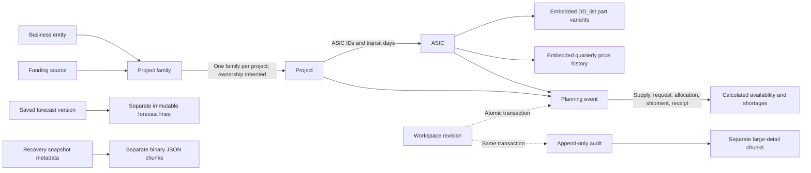

# Data model

MongoDB 8.0 is the source of truth. The Python/PyMongo repository stores live records in separate collections; it does not store the complete live workspace in one BSON document. Versioned collection setup is applied by `PYTHONPATH=backend python -m app.migrate` with a schema-owner credential. The schema version is `20261030_0001`. The application starts empty; existing data transfers only through an explicit administrator JSON import.

## Presentation diagram



Arrows describe application references and embedded data, not database foreign keys. A family has exactly one business entity and one funding source. The domain layer validates reference integrity, names/keys, parent cycles, deletion rules and planning limits before a transaction commits.

## Collections and ownership

| Collection | Stored information and important rules |
| --- | --- |
| `business_entity` | Name, description and optional archive/compatibility metadata. Names are unique after trimming and case folding. |
| `funding_source` | Funding source with the same name rules. |
| `project_family` | Required business entity and funding source IDs; source of inherited project ownership. |
| `project` | Required family, project name and EPM; optional key, SCPM, platform, prototype flag, parent and description. Associated ASIC IDs and per-ASIC transit settings are embedded. |
| `asic` | Name, supply chain owner, marketing name, description and optional price. DD_list part variants and quarterly price history are embedded arrays. Part IDs are globally unique; normalized MPNs are unique within an ASIC. |
| `planning_event` | Supply, requests, allocations, shipments and arrivals, including legacy references and shipment baselines. |
| `forecast_version` | Saved monthly forecast header, ID, label and timestamp. Version month is unique. |
| `forecast_line` | Ordered frozen lines stored separately from the header: historical IDs/labels, category, phase, event type, period and quantity. |
| `recovery_snapshot` | ID, position, date, label, chunk count and SHA-256 checksum. Recovery copies are historical, not the live workspace. |
| `snapshot_chunk` | Ordered 512 KiB binary chunks of UTF-8 snapshot JSON. |
| `workspace_meta` | Singleton `_id: "workspace"`, schema version, revision, frontend contract version, audit sequence and compatibility `extra`. No live ASIC, project or event arrays. |
| `audit_entry` | ID, sequence, workspace revision and server audit `record`. Large details use a chunk count and SHA-256 checksum. |
| `audit_chunk` | Ordered 512 KiB binary chunks of large UTF-8 audit detail; append-only like its audit entry. |

Most entity documents wrap the accepted API record without renaming its fields:

```json
{
  "_id": "stable-original-record-id",
  "position": 0,
  "record": {
    "id": "stable-original-record-id",
    "name": "User-entered name"
  }
}
```

`position` preserves frontend ordering. `record` preserves accepted compatibility fields, including part-level metadata, original timestamps, absent legacy defaults and unused transit settings. Workspace `extra` retains `source`, legacy `pendingRequests` and accepted unknown metadata; active requests are planning events.

Versioned schema setup creates collection validators and indexes. IDs, audit sequences and chunk positions have uniqueness protection. Domain uniqueness for normalized names, project keys, MPNs and forecast months is checked under the global revision transaction; this also permits atomic swaps of names or keys. These business checks must not be bypassed by direct database writes. The runtime grants are mutable planning/recovery collections: `find`/`insert`/`update`/`remove`; `workspace_meta`: `find`/`update`; both audit collections: `find`/`insert`; and database-level `listCollections`/`listIndexes`. The runtime cannot create/drop collections, modify validators/indexes, bypass validation or manage users.

A family's ownership is stored once. Responses derive `businessEntityId`, `fundingSourceId`, `entity` and `funding` on projects. Changing family ownership changes what its projects inherit. An optional parent provides hierarchy and does not override family ownership.

## Planning events

| API `type` | Meaning | Project | Relevant dates |
| --- | --- | --- | --- |
| `expected_ship` | Available or incoming inventory | Absent; shared by ASIC | `date` is availability; `supplyStatus` distinguishes available from incoming. |
| `request` | User demand | Required | `date` is requested arrival; `requestedShipDate`, when present, is ship-by. |
| `expected_fulfilment` | Explicit user allocation | Required | `date` is planned arrival; `availableShipDate`, when present, is planned dispatch. |
| `actual_ship` | Recorded shipment | Required | `date` is dispatch; required `eta` is on or after dispatch. |
| `actual_fulfilment` | Recorded arrival | Required | `date` is arrival. |

Quantities are positive safe whole numbers and transit days are nonnegative. Request ship-by and allocation dispatch cannot be after their arrival dates. Valid historical fields retained from an earlier event type remain compatibility metadata.

Within an ASIC/project, an exact request event ID takes precedence over a colliding alias. Without an exact match, shared legacy aliases retain FIFO behavior. Unresolved historical allocation references retain project-pool semantics; unresolved explicitly linked shipments do not credit unrelated requests. Baselines prevent completed shipments being credited to a newly created normal allocation. Reallocation creates a new target and retains shipped units on the source.

The Python planner calculates inventory, allocation backing and shortages. Reading availability never creates allocations. Predictions are calculated results, not extra inventory documents.

## History, deletion and audit

Frozen forecast labels and quantities remain valid after live masters change or disappear. Normal edits cannot rewrite saved forecasts or existing recovery points; new captures must match server-validated state. Explicit administrator import/restore is a separate workflow. Recovery points rotate at a maximum of 30 and are not database backups.

Authorized changes explicitly remove deleted live documents and related data. Domain validation protects remaining references; there are no hidden database cascades. Archive metadata does not turn deletion into archiving. Audit, forecasts and recovery can retain deleted information, so deleting a current record does not imply historical erasure.

The server ignores client audit additions, deletions and actor claims during normal edits. A successful write appends an authenticated entry. Imported legacy entries have an unknown original actor. `audit_entry.record` includes `id`, `date`, `action`, `detail`, `actor`, `actorName`, `actorRole`, `legacy` and `revision`; oversized detail is reconstructed from checksummed chunks. The runtime role has only `find` and `insert` on both audit collections. Owners and privileged operators require separate controls.

## Transactions and roles

MongoDB must support multi-document transactions through a replica set or compatible sharded cluster; a standalone server is unsupported. Verification used a replica set. The repository uses snapshot reads and majority write concern. A save conditionally updates the singleton revision and applies records and audit in the same transaction. Stale or competing revisions return HTTP 409 without a partial save. Returned state/revision describes one committed workspace. See [MongoDB transaction requirements](https://www.mongodb.com/docs/v8.0/core/transactions-production-consideration/).

The API still exchanges complete workspace JSON. Payload size and transaction work grow with retained history. Larger deployments need entity-level APIs, paginated history, load tests and a reviewed retention/export policy.

Viewer/editor/admin are application roles supplied by trusted ingress, separate from MongoDB accounts. Users share one workspace; there is no per-business-entity document security.

## Dates, quantities and cost

- Operational dates are validated `YYYY-MM-DD` strings, not BSON dates; timezone conversion does not move ship-by dates. Supported years are 0001–9999.
- Forecast periods use `YYYY-MM`; quarterly prices use `YYYY-Qn`.
- Creation/update/capture timestamps retain ISO text. Missing or date-only event timestamps retain historical FIFO behavior. Full timestamps compare by instant, with Pacific-day semantics where applicable.
- USD prices remain validated JSON numbers, not `Decimal128`: finite, nonnegative, at most two decimal places, maximum `9,999,999,999.99`. Unknown is `null`, distinct from zero.
- Quantities stay within JavaScript's safe integer range. Currency is implicit; multiple currencies require a model/API change.
- Each BSON document has a separate [16 MiB limit](https://www.mongodb.com/docs/v8.0/core/document/). Forecast lines, recovery data and large audit details are separated; an oversized ordinary entity/metadata document is rejected with 422 before a partial save. The 32 MiB supported HTTP maximum does not waive per-document limits.

The workspace JSON contract remains version 2. Exported JSON from the PostgreSQL-backed application can be imported by an administrator; SQL schema files and database dumps cannot be loaded directly into MongoDB. See [README.md](../README.md) for transition and reviewed legacy-family mapping.
