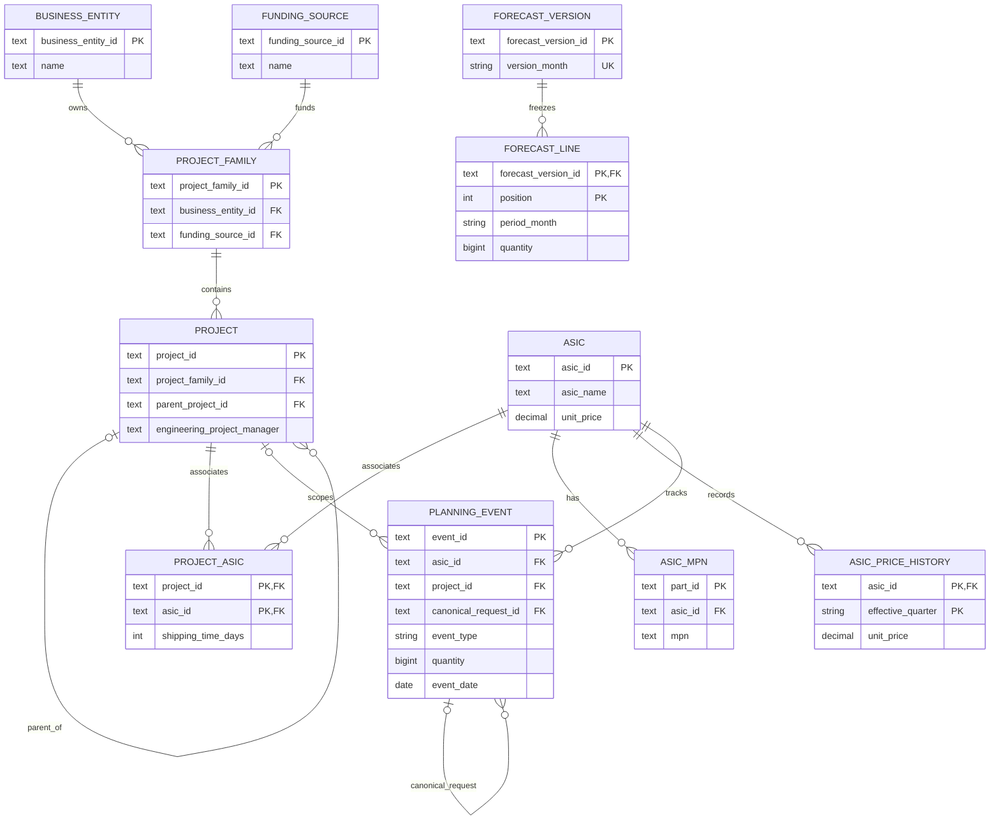

# Data model

PostgreSQL is the source of truth. SQLAlchemy models live in `backend/app/models.py`; the initial, frozen Alembic migration is `20261029_0001`. The application starts empty. Existing demo data is transferred only through the explicit administrator import workflow.

## Relationships

`recovery_snapshot`, `workspace_meta`, and `audit_entry` support recovery, concurrency, and change history. They have no foreign keys to the mutable business records.

## Tables and ownership

| Table | Purpose and important rules |
| --- | --- |
| `business_entity` | Named business entity, description, optional archive timestamp. Name is unique after trimming and case folding. |
| `funding_source` | Named funding source with the same name rules. |
| `project_family` | Exactly one business entity and one funding source, both required foreign keys. |
| `project` | Required family, project name and engineering project manager; optional unique project key, supply chain program manager, platform, prototype flag, parent project and description. |
| `asic` | ASIC name, required supply chain owner, marketing name, optional unit price and description. |
| `asic_mpn` | One row per ASIC part variant: globally unique part ID, MPN, customer part number, PLID, assembly description, and component subtype. MPN is unique within its ASIC after trimming and case folding. These columns support the DD_list detail view. |
| `asic_price_history` | Per-ASIC prices keyed by quarter, such as `2026-Q4`; compound primary key `(asic_id, effective_quarter)`. |
| `project_asic` | Many-to-many project/ASIC association, keyed by `(project_id, asic_id)`, with nonnegative shipping time in days. |
| `planning_event` | Supply, request, allocation, shipment and arrival records. See event semantics below. |
| `forecast_version` | Named forecast capture, unique version month and original capture timestamp. |
| `forecast_line` | Ordered frozen lines keyed by `(forecast_version_id, position)`. Carries historical ASIC/project IDs and names, category, phase, event type, period month, quantity and optional source event ID. |
| `recovery_snapshot` | Explicit recovery capture: ID, capture timestamp, label and JSONB state copy. This historical copy is not the live data source. |
| `workspace_meta` | Singleton row `id = 1`, current workspace revision, frontend contract version and compatibility metadata. It contains no live ASIC, project, event or forecast arrays. |
| `audit_entry` | Ordered server change ledger: ID, sequence, workspace revision, time, action, before/after change details, authenticated actor and role. Imported legacy records have an unknown actor and an explicit legacy flag. |

Project family is the only stored source of a project's business entity and funding source. The API derives `businessEntityId`, `fundingSourceId`, `entity` and `funding` on project responses for the existing frontend. Changing a family's ownership changes what all its projects inherit. An optional parent project provides hierarchy; it does not override family ownership. The domain layer rejects parent cycles, while the database rejects self-parenting and missing parents.

Most master and detail records have an explicit `position` to retain frontend ordering. Per-record `extra` JSONB fields preserve accepted legacy metadata without replacing relational fields. The workspace compatibility fields include `source` and legacy `pendingRequests`; active requests are `planning_event` rows.

## Planning events

| Stored `event_type` | Meaning | Project | Relevant dates |
| --- | --- | --- | --- |
| `expected_ship` | Inventory available or expected to become available | Absent; supply is shared by ASIC | `event_date` is supply availability date. Metadata distinguishes expected from available inventory. |
| `request` | User demand | Required | `event_date` is requested arrival; `requested_ship_date`, when present, is the ship-by date. |
| `expected_fulfilment` | Explicit user allocation | Required | `event_date` is planned arrival; `available_ship_date`, when present, is planned dispatch. |
| `actual_ship` | Recorded shipment | Required | `event_date` is dispatch; required `eta` is on or after dispatch. |
| `actual_fulfilment` | Recorded arrival | Required | `event_date` is arrival. |

Quantity is a positive integer within JavaScript's safe integer range. Transit days are nonnegative. Request ship-by and allocation dispatch dates cannot be after their respective arrival dates. Valid dates retained from a previous event type remain compatibility metadata.

`request_reference` preserves the entered legacy request ID or alias. When it resolves unambiguously to a request on the same project and ASIC, the repository also stores `canonical_request_id`. Unmatched historical reference text remains available. The deferred self-reference permits an atomic transaction to add or remove related events.

Inventory availability and shortages are calculated by the Python planning service from supply and planning events. No allocation is created by reading an availability report. An allocation requires an explicit write. Availability predictions are calculated results, not additional inventory records.

## Historical data, deletion and audit

Forecast lines deliberately have no foreign keys from their historical ASIC/project/source-event IDs to live masters. Renaming or deleting a current ASIC or project therefore preserves the labels and quantities captured in an earlier forecast. The API validates new forecast captures against server data and prevents changing existing captures during normal edits. Explicit administrator import and restore workflows are separate.

Recovery snapshots retain a full JSONB state at capture time. The application keeps at most 30 recovery points, rotating the oldest when a new point is added. Normal edits cannot rewrite an existing snapshot. They are recovery artifacts in addition to the relational live tables, not a substitute for PostgreSQL backups.

Authorized workspace updates physically delete removed current rows, with children handled explicitly before parents. Master foreign keys generally restrict deletion; there is no broad hidden cascade across business records. Forecast lines cascade only when their own forecast version is removed. Optional archive timestamps are also represented in the model; their presence does not silently turn deletion into archiving. Audit and retained recovery copies can still contain information about deleted records, so deletion from the current view does not guarantee historical erasure.

The server ignores submitted client audit entries during ordinary edits. Every successful write appends an entry attributed to the authenticated actor. Administrator imports may add previously unseen legacy entries, but their actor is recorded as unknown. Existing server history cannot be replaced by a client payload. The PostgreSQL migration adds an audit trigger rejecting row `UPDATE` and `DELETE`; database owners and privileged operators must still be governed separately, including permissions for `TRUNCATE`, schema changes and backups.

## Transactions and application roles

The current API exchanges a complete workspace and revision. Every read and write locks the singleton revision row while assembling or saving the relational state. A write must provide the revision it read; a stale write returns a conflict without committing any business changes. The revision increment, row changes and new audit entry commit together. Concurrent writers cannot silently overwrite one another. The repository leaves commit/rollback to the API transaction.

Application roles are supplied by the trusted authenticated ingress: viewers read, editors change operational data, and administrators also import or restore workspaces. They are application authorization roles, not PostgreSQL accounts or row-level security policies. The hosting team must provision database credentials and least-privilege database access independently. Audit actor fields describe the authenticated application identity.

This coarse workspace API suits an initial small-team deployment. It returns the complete audit and retained recovery history without silent truncation. Payload size and lock duration grow with events, forecasts, snapshots and audit records. Larger deployments should introduce resource-level endpoints, paginated history and a documented retention/export policy before increasing data volume or concurrency.

## Dates, quantities and cost

- Operational dates use PostgreSQL `DATE` and API `YYYY-MM-DD` values; timezone conversion does not move a ship-by date.
- Forecast versions and periods use `YYYY-MM`; price history uses `YYYY-Qn`. API validation checks their calendar format.
- Database-generated technical timestamps use `TIMESTAMP WITH TIME ZONE`. Original event creation/update strings are also retained verbatim because older date-only values affect request ordering. Captured forecast, recovery and audit timestamps preserve their accepted ISO representation.
- Unit prices use `NUMERIC(12,2)`, allowing up to `9,999,999,999.99`. API validation rejects negative, nonfinite, excess-precision and out-of-range prices; database constraints provide additional protection. An unknown unit price is `NULL`, distinct from a known zero price. Historical price-unknown flags and accepted legacy metadata are retained.
- Quantities are whole units, not currency. The database stores safe integers. Currency is not modeled as a separate field in this release; confirm the intended single reporting currency before introducing multi-currency costs.

Foreign keys, compound primary keys, named constraints and lookup indexes are defined in the migration. Business invariants involving multiple records—such as family inheritance, parent cycles and planning limits—are additionally validated by the Python domain layer.
